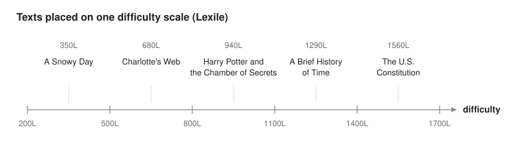
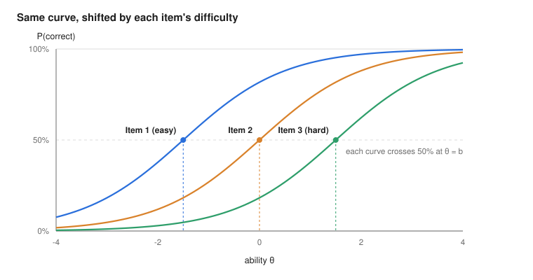

Purpose: to build up item response theory from the ground up, starting with the 1PL. Each modeling choice comes with its justification and an intuitive picture, and the ideas are connected to econometrics. Simulations, with estimators written from scratch and checked against standard software, test the understanding along the way. The note grows as new topics are added.

Code: [github.com/ylee141/irt-1pl-simulation](https://github.com/ylee141/irt-1pl-simulation)

## Introduction

### Motivation

- Schools and testing programs need to know where students stand, to:
  - admit them,
  - place them in the right classes,
  - decide what to teach next,
  - track their progress.
- Oftentimes, a student's ability (e.g. in reading or math) can't be observed directly, so it has to be inferred from evidence.
- The most common evidence is answers to questions:
  - the same questions can be given to many students,
  - answers can be scored easily,
  - scores can be compared across students (when everyone takes the same test).

### Goal

- Estimate a student's "ability" from their answers to test questions,
  - **reliably:** consistently, with small measurement error,
  - **practically:** still working when tests change over time, so an estimate means the same thing whichever questions were answered.

### Problem

- Answers mix two things we normally can't observe: the student's ability and the questions' difficulty.
  - Students often take different test sets (to prevent copying, to fit each student's level, to update content).
  - 9/10 on an easy set vs. 6/10 on a hard set: is the first a strong student, or were the questions easy?
  - Raw scores can't tell the two apart, so they can't compare students who took different sets.
- So we need to separate ability from difficulty, using the answers alone.
- To picture what ability and difficulty could mean, compare three settings:

| Setting | Difficulty | Ability |
|---|---|---|
| D&D skill check | observable: the number the dice roll must reach | observable: the character's skill bonus added to the roll |
| Weightlifting | observable: the weight on the bar | not observable |
| Answering a test question | not observable | not observable |

- What the table shows:
  - In all three, we see whether the attempt succeeded.
  - In some settings, we can directly observe the difficulty or the ability. These can help build a concrete picture of what difficulty and ability could mean in a test.
  - In a test, both difficulty and ability are unobserved and need to be estimated from the observed answers.

### Solution

- Since ability and difficulty can't be observed directly, we estimate them from the answers through a model, in three steps:
  - We give each student an ability $\theta_i$ and each question a difficulty $b_j$.
  - We create a map from ability and difficulty to the probability of a student answering a question correctly.
  - We back out the parameters using likelihood maximization.
- Because each question keeps its own difficulty, students who answered different sets of questions can be placed on one scale.
  - It would be very frustrating if a lifter's ability (the most she can usually lift, in kilograms) and the weight on the bar were on different scales: we could not compare lifters who attempted different weights.
- The shared scale also lets a student be compared directly with any question, so students can be matched with material at their level.
  - For a real world example, the Lexile framework:
    - Places readers and books on the same scale.
    - A reader at 800L is matched with books near 800L. At that match, the reader is expected to understand about 75% of the text. (Lexile sets a match at 75%; in the 1PL, $b_j$ is the 50% point.)



## Modeling

### Setup

- $N$ students each answer $J$ questions. The answers form a gradebook: a table $X$ with one row per student and one column per question.
- $X_{ij} = 1$ if student $i$ answers question $j$ correctly, and 0 otherwise.
- For example, with 4 students and 3 questions:

|     | Q1 | Q2 | Q3 |
|-----|:--:|:--:|:--:|
| Ann | 1  | 1  | 0  |
| Ben | 1  | 0  | 1  |
| Cal | 0  | 1  | 0  |
| Dan | 1  | 0  | 0  |

- We observe $X$. The unknowns are an ability $\theta_i$ for each student and a difficulty $b_j$ for each question.

### Choosing a form

- We choose a functional form linking $\theta_i$ and $b_j$ to the probability of a correct answer.
- A good form lets us estimate the parameters well enough to inform decisions. Among those, we prefer one that is:
  - simple: easier to estimate and to check,
  - interpretable: each parameter has a clear meaning.
- We look for a function $f$ with $P(X_{ij} = 1 \mid \theta_i, b_j) = f(\theta_i, b_j)$ that satisfies:
  - $f$ gives a valid probability, strictly between 0 and 1, for any values of $\theta_i$ and $b_j$.
  - $f$ increases in $\theta_i$ and decreases in $b_j$ (monotonicity).

### The one-parameter logistic (1PL) model

- The simplest model has only $\theta_i$ and $b_j$ as parameters: one per student and one per question.
- $f$ depends on the two only through their gap, $\theta_i - b_j$.
  - Why: it is a simple way to combine the two. A more complex form is worth it only if it brings a clear benefit.
  - Students and questions sit on one scale, so they can be compared directly (as in the Lexile example).
- We choose the logistic function of the gap, which is the standard choice:

  $$
  P(X_{ij} = 1 \mid \theta_i, b_j) = \frac{\exp(\theta_i - b_j)}{1 + \exp(\theta_i - b_j)}
  $$

  - It gives a probability strictly between 0 and 1 for any gap, and rises with the gap, so it meets both requirements.
  - Among such functions, it is the simplest to work with and the easiest to read.
  - One parameter per question ($b_j$) and the logistic function: hence the name one-parameter logistic (1PL).
- The log-odds equals the gap: $\log\big(P / (1 - P)\big) = \theta_i - b_j$. So one unit of gap multiplies the odds of a correct answer by $e$ (about 2.7).
- When $\theta_i = b_j$, the chance is 50%. So the difficulty $b_j$ is the ability level at which a student has a 50% chance of answering question $j$ correctly.
- So $\theta_i$ and $b_j$ are defined through each other: only their gap has a meaning on its own.

### Item characteristic curve (ICC)

- A question is also called an item, as is standard in IRT.
- The item characteristic curve (ICC) plots $P(\text{correct})$ against ability $\theta$ for one item.



- Every item has the same S-shaped curve, shifted along by its difficulty $b_j$.
- Each curve crosses 50% at $\theta = b_j$: a harder item sits further right.
- The curves never cross, which implies that every student agrees on which item is harder.

### Latent variable formulation and the role of luck

- The 1PL gives only the chance of a correct answer.
  - The same student could get the same item right one day and wrong another. Whatever decides each answer beyond ability and difficulty, we call the idiosyncratic term: it covers anything specific to this student and item, luck in particular.
- In some settings, this term can be observed:
  - D&D skill check: the character succeeds when skill bonus + die roll $\ge$ the number to reach. The die roll is the luck: every character rolls the same die. With a d4 the bonus decides most checks, while with a d20 the roll often does.
  - Weightlifting: the lifter makes the lift when the most she can usually lift + this attempt's luck $\ge$ the weight on the bar. The luck is how well that one lift goes, measured in kilograms.
- In most tests, it can't be seen, but we write each answer the same way, through an underlying latent variable $Z_{ij}$:

$$
Z_{ij} = a(\theta_i - b_j) + \varepsilon_{ij}, \qquad X_{ij} = \mathbf{1}\{Z_{ij} \ge 0\}
$$

- $\varepsilon_{ij}$ is the idiosyncratic term, and the student answers correctly when $Z_{ij} \ge 0$.
- We observe only $X_{ij}$, so the data show the gap only relative to $\varepsilon_{ij}$.
  - $a$ sets the balance: with a large $a$, the gap decides almost every answer and luck matters little; as $a \to 0$, every answer becomes a coin toss.
  - So $a$ measures how sharply an item separates stronger students from weaker ones. This is why $a$ is called the discrimination.
  - The 1PL uses the same $a$ for every item, so it is implicitly assumed that every item is equally informative. Letting $a$ differ by item, as $a_j$, gives the two-parameter logistic (2PL) model.
  - So the answers pin down only $a(\theta_i - b_j)$ compared with $\varepsilon_{ij}$, and a unit has to be fixed before anything can be estimated.
- For 1PL, we take $\varepsilon_{ij}$ to be standard logistic.
  - This gives back the 1PL formula: $P(X_{ij} = 1) = P(Z_{ij} \ge 0) = \Lambda\big(a(\theta_i - b_j)\big)$.
  - Its mean and spread are conventions: the mean sets the zero of the scale, and the spread, together with $a$, sets the unit (see Identification).
- The systematic part is simple, so most of the model's assumptions are about $\varepsilon_{ij}$. The next section lists them together with the other assumptions.

## Assumptions

- We need specific assumptions to hold for the model to work.
- Recall the model, with the idiosyncratic term written out:

$$
P(X_{ij} = 1 \mid \theta_i, b_j) = \Lambda\big(a(\theta_i - b_j)\big), \qquad Z_{ij} = a(\theta_i - b_j) + \varepsilon_{ij}, \quad X_{ij} = \mathbf{1}\{Z_{ij} \ge 0\}
$$

### Structure

- Unidimensionality: a single ability drives every answer.

  $$
  P(X_{ij} = 1 \mid \theta_i, \nu_i) = P(X_{ij} = 1 \mid \theta_i) \quad \text{for any other student trait } \nu_i
  $$

  - Once $\theta_i$ is known, nothing else about the student changes the chance.
  - Violation: a math test with long word problems also draws on reading. Two students with the same math ability but different reading ability then have different chances on those items.

- Monotonicity: a stronger student is never less likely to answer correctly.

  $$
  \frac{\partial}{\partial \theta_i} P(X_{ij} = 1 \mid \theta_i, b_j) > 0
  $$

  - The 1PL builds this in, since $a > 0$.
  - Violation: a trick question that strong students overthink, so weaker students do better on it.

- Functional form: the chance follows the logistic curve.

  $$
  \varepsilon_{ij} \sim \text{Logistic}(0, 1) \;\Rightarrow\; P(X_{ij} = 1 \mid \theta_i, b_j) = \Lambda\big(a(\theta_i - b_j)\big)
  $$

  - So the chance goes to 0 for very weak students and to 1 for very strong ones.
  - Violation: with four-option multiple choice, even the weakest student guesses right about 25% of the time (a floor), and a careless slip can keep even the strongest below 100% (a ceiling).

### Independence

- Idiosyncratic term unrelated to ability: $\varepsilon_{ij}$ does not depend on how able the student is.

  $$
  \varepsilon_{ij} \perp \theta_i
  $$

  - What decides an answer beyond the gap behaves the same way for strong and weak students.
  - Violation: weak students guess more, so their answers carry more luck than strong students' answers.

- Local independence: once ability is known, a student's answers to different items are independent.

  $$
  P(X_{i1} = x_1, \dots, X_{iJ} = x_J \mid \theta_i) = \prod_{j=1}^{J} P(X_{ij} = x_j \mid \theta_i), \qquad \text{equivalently } \varepsilon_{ij} \perp \varepsilon_{ik} \ (j \ne k)
  $$

  - $\theta_i$ explains everything the items share; what is left is specific to each item.
  - Violations:
    - Subquestions: items built on one passage have related $\varepsilon_{ij}$, since misreading the passage hurts all of them.
    - Fatigue: a tired student's $\varepsilon_{ij}$ drops on all the late items together.
    - A shared unobserved ability: if some items also need reading, a strong reader's $\varepsilon_{ij}$ is higher on all of them together.

- Independence across students: one student's $\varepsilon_{ij}$ is unrelated to another's.

  $$
  \varepsilon_{ij} \perp \varepsilon_{kl} \quad (i \ne k)
  $$

  - Violation: copying or group work, so two students' answers move together.

### Invariance

- If the model holds, an item's difficulty does not depend on which students answered it, and a student's ability does not depend on which items she answered.
  - With raw scores, the same item looks easy in a strong class and hard in a weak one. Under the 1PL, both classes give the same $b_j$, up to the choice of zero and unit.
  - This is what lets students who took different test sets be placed on one scale.
- In the 1PL, comparing two students does not involve any item, and comparing two items does not involve any student:

  $$
  \text{logit}\,P_{ij} - \text{logit}\,P_{kj} = a(\theta_i - \theta_k), \qquad \text{logit}\,P_{ij} - \text{logit}\,P_{il} = a(b_l - b_j)
  $$

  - $b_j$ cancels in the first and $\theta_i$ in the second. The Rasch tradition calls this specific objectivity.
  - It needs the same $a$ everywhere. With item-specific $a_j$ (the 2PL), the student comparison becomes $a_j(\theta_i - \theta_k)$, so its size depends on which item is used.
- The property holds only if the parameters really stay fixed across items, students and groups, which the assumptions below state:

- Equal discrimination: every item weighs the gap against $\varepsilon_{ij}$ the same way.

  $$
  a_j = a \quad \text{for every item } j
  $$

  - Every ICC has the same steepness, so the curves never cross.
  - Violation: a clearly worded item separates students sharply, while an ambiguous one is close to a coin toss for everyone.

- Same $a$ across students and groups.

  $$
  a_{ij} = a \ \text{for every student } i, \qquad a_g = a \ \text{for every group } g
  $$

  - Violation: a careless student, or a group taking a low-stakes test, answers with more luck.

- No differential item functioning (DIF): an item is equally hard for every group at the same ability.

  $$
  P(X_{ij} = 1 \mid \theta_i, G_i = g) = P(X_{ij} = 1 \mid \theta_i), \qquad \text{i.e. } b_{jg} = b_j
  $$

  - Violation: a word problem about hockey is easier for Canadian students than for others of the same ability.

## Identification

- The answers depend on the parameters only through $a(\theta_i - b_j)$. So different parameter values can give exactly the same probabilities, and the data cannot tell them apart.

### Location and scale

- Location: shifting every student and every item by the same amount $c$ changes nothing.

  $$
  \theta_i \to \theta_i + c, \quad b_j \to b_j + c \quad \Rightarrow \quad a(\theta_i - b_j) \text{ unchanged}
  $$

  - So the zero of the scale is arbitrary.

- Scale: stretching $\theta$ and $b$ by $k$ and shrinking $a$ by the same $k$ changes nothing.

  $$
  \theta_i \to k\theta_i, \quad b_j \to k b_j, \quad a \to a/k \quad \Rightarrow \quad a(\theta_i - b_j) \text{ unchanged}
  $$

  - So the unit of the scale is arbitrary too.

- So we fix one zero and one unit by convention:
  - Zero: mean $\theta = 0$ (MML), or $\sum_j b_j = 0$ (JML, as in our code).
  - Unit: fix $a = 1$ and measure in units of $\varepsilon_{ij}$'s spread (Rasch, as in our code), or fix $\text{SD}(\theta) = 1$ and estimate $a$.
  - The basic 1PL fixes $a = 1$, which is why $a$ does not appear in the earlier formulas.

- The two unit conventions convert into each other:

  $$
  \theta_i^{\text{SD}} = \theta_i / \sigma, \quad b_j^{\text{SD}} = b_j / \sigma, \quad a^{\text{SD}} = \sigma
  $$

  - $\sigma$ is the SD of $\theta$ under $a = 1$. In our simulation, $\hat\sigma \approx 1.9$.
  - The fit is the same either way; only the numbers on the scale change.

## Estimation

- Local independence and independence across students make the probability of the whole gradebook a product:

  $$
  L(\theta, b) = \prod_{i=1}^{N} \prod_{j=1}^{J} P_{ij}^{\,x_{ij}} (1 - P_{ij})^{1 - x_{ij}}, \qquad P_{ij} = \Lambda(\theta_i - b_j)
  $$

- We estimate the parameters by choosing the values that make the observed gradebook most likely. JML and MML differ in how they treat $\theta_i$.

### Joint Maximum Likelihood (JML)

- Each $\theta_i$ is treated as an unknown number and estimated together with the $b_j$, by maximizing the log-likelihood over all of them at once:

  $$
  (\hat\theta, \hat b) = \arg\max_{\theta,\, b} \log L(\theta, b) \quad \text{subject to} \quad \sum_j b_j = 0
  $$

  - The zero is fixed by $\sum_j b_j = 0$ and the unit by $a = 1$ (see Identification).
  - Students with perfect or zero scores have no finite $\hat\theta_i$ and are dropped: a higher $\theta_i$ always makes "all correct" more likely, so $\hat\theta_i \to \infty$ (and $\to -\infty$ for all wrong).
- Weakness: the $\hat b_j$ are stretched outward, even with many students.
  - Each $\theta_i$ rests on only $J$ answers, so $\hat\theta_i$ is noisy, and since the number of $\theta$'s grows with $N$, this noise never averages away.
  - The noise spreads the estimated abilities apart, and the $\hat b_j$ stretch with them, by roughly $J/(J - 1)$. This is the incidental parameter (Neyman–Scott) problem.
  - A common fix multiplies the $\hat b_j$ by $(J - 1)/J$.

### Marginal Maximum Likelihood (MML)

- Each $\theta_i$ is treated as a draw from a distribution, and the $\theta$'s are integrated out:

  $$
  L(b, \sigma) = \prod_{i=1}^{N} \int \prod_{j=1}^{J} P(X_{ij} = x_{ij} \mid \theta)\, \phi(\theta;\, 0, \sigma^2)\, d\theta
  $$

  - The unknowns are only the $b_j$ and $\sigma$, so their number does not grow with $N$.
  - So the stretching that affects JML goes away.

- Distribution of ability: abilities are drawn independently from a normal distribution.

  $$
  \theta_i \overset{iid}{\sim} N(0, \sigma^2)
  $$

  - Under the $a = 1$ convention, $\sigma$ is estimated.
  - JML does not need this, since it treats each $\theta_i$ as a fixed unknown.
  - Violation: a class that mixes two very different groups, such as first-timers and repeat test-takers, has a two-peaked distribution.

- Perfect and zero scores stay in: MML averages over the ability distribution instead of estimating each $\theta_i$, so "all correct" has the probability that a random student gets everything right, which is finite.
- The integral has no closed form, so it is approximated numerically, by quadrature or by averaging over random draws of $\theta$.

## Simulation setup

- We simulate a gradebook from a known 1PL model, estimate it with JML and MML, and compare the estimates with the true values.
- The code: [`01_simulate_data.R`](https://github.com/ylee141/irt-1pl-simulation/blob/main/01_simulate_data.R), [`02_estimate_jml.R`](https://github.com/ylee141/irt-1pl-simulation/blob/main/02_estimate_jml.R), [`03_estimate_mml.R`](https://github.com/ylee141/irt-1pl-simulation/blob/main/03_estimate_mml.R).

### Data

- $N = 500$ students answer $J = 10$ items.
- True parameters:

  $$
  \theta_i \overset{iid}{\sim} N(0, 2^2), \qquad b_j \in \{-2, \dots, 2\} \text{ (10 evenly spaced values)}, \qquad a = 1
  $$

- Answers are drawn from the model:

  $$
  X_{ij} \sim \text{Bernoulli}\big(\Lambda(\theta_i - b_j)\big)
  $$

  - With $\sigma = 2$, abilities are spread wide, so some students get every item right or wrong.

### JML

- Students with perfect or zero scores are dropped.
- The last difficulty is set to minus the sum of the others, so $\sum_j b_j = 0$.
- The log-likelihood is maximized over all remaining $\theta_i$ and $b_j$ at once with BFGS, starting from 0.
- The $\hat b_j$ are multiplied by $(J - 1)/J$ to correct the stretching. Standard errors come from the Hessian.

### MML

- The integral over ability is approximated by simulation: each student gets $R = 100$ fixed standard normal draws $z_{ir}$, and $\theta_{ir} = \sigma z_{ir}$.

  $$
  L(b, \sigma) \approx \prod_{i=1}^{N} \frac{1}{R} \sum_{r=1}^{R} \prod_{j=1}^{J} P(X_{ij} = x_{ij} \mid \theta_{ir})
  $$

  - The draws are fixed once, so the likelihood stays smooth while the optimizer searches.
- Probabilities are computed on the log scale, $\log \Lambda$ and $\log(1 - \Lambda)$ directly, so extreme gaps do not round to $\log 0$. JML does the same.
  - The average over draws is taken after exponentiating the log-likelihoods, which is safe with 10 items; longer tests would need the log-sum-exp trick.
- The parameters are the 10 $b_j$ and $\log\sigma$ (so $\sigma$ stays positive), maximized with BFGS starting from $b_j = 0$ and $\sigma = 1$.
- The zero is set by mean $\theta = 0$, so the $\hat b_j$ are centered before comparing them with the true values.
- As a check, the same data are fitted with the mirt package (`itemtype = "Rasch"`), which integrates by quadrature.

## Results

```{r}
#| label: run-jml
#| include: false
source("02_estimate_jml.R")

# Save the JML results before the MML script overwrites shared names
jml <- list(
  b_raw     = b_hat,
  b_corr    = b_hat_corr,
  se_corr   = b_se_corr,
  n_dropped = sum(!keep)
)
```

```{r}
#| label: run-mml
#| include: false
source("03_estimate_mml.R")

# Centered MML difficulties share the true values' zero (sum of b = 0)
mml_c <- b_mml - mean(b_mml)

# Slope of estimates on true values: 1 = no stretching
slope <- function(est) unname(coef(lm(est ~ b_true))[2])
```

### Data check

- JML dropped `r jml$n_dropped` of the `r N` students for perfect or zero scores. MML keeps all `r N`.
- The share of correct answers falls from `r round(max(colMeans(X)), 2)` on the easiest item to `r round(min(colMeans(X)), 2)` on the hardest, as the difficulties rise.

### Item difficulties

```{r}
#| label: tbl-b
#| echo: false
#| tbl-cap: "True and estimated item difficulties (MML centered)"
knitr::kable(
  data.frame(
    Item            = 1:J,
    True            = b_true,
    `JML raw`       = jml$b_raw,
    `JML corrected` = jml$b_corr,
    MML             = mml_c,
    check.names = FALSE
  ),
  digits = 2,
  row.names = FALSE
)
```

```{r}
#| label: fig-b
#| echo: false
#| fig-cap: "Estimated against true difficulties. Points on the dashed line match the truth."
lims <- range(b_true, jml$b_raw, jml$b_corr, mml_c)
plot(b_true, jml$b_raw, pch = 1, col = "grey40", xlim = lims, ylim = lims,
     xlab = "true b", ylab = "estimated b")
points(b_true, jml$b_corr, pch = 16, col = "steelblue")
points(b_true, mml_c, pch = 17, col = "darkorange")
abline(0, 1, lty = 2)
legend("topleft", legend = c("JML raw", "JML corrected", "MML"),
       pch = c(1, 16, 17), col = c("grey40", "steelblue", "darkorange"), bty = "n")
```

- JML without correction is stretched outward: regressing its estimates on the true values gives a slope of `r round(slope(jml$b_raw), 2)`, against the $J/(J-1) =$ `r round(J / (J - 1), 2)` that Estimation predicts.
- The $(J-1)/J$ correction brings the slope to `r round(slope(jml$b_corr), 2)`.
- MML, with no correction, gives a slope of `r round(slope(mml_c), 2)`.

### Checking MML against mirt

- Both use the same zero (mean $\theta = 0$), so the estimates and standard errors are compared as they are.

```{r}
#| label: tbl-mirt
#| echo: false
#| tbl-cap: "Our MML and mirt: difficulties and standard errors"
knitr::kable(
  data.frame(
    Item          = 1:J,
    MML           = b_mml,
    `SE (MML)`    = b_se_mml,
    mirt          = b_mirt,
    `SE (mirt)`   = b_se_mirt,
    check.names = FALSE
  ),
  digits = 3,
  row.names = FALSE
)
```

- The largest difference between the two on any item is `r round(max(abs(b_mml - b_mirt)), 3)`.

### Spread of ability

- The true $\sigma$ is `r sigma_true`. Our MML estimates `r format(round(sigma_mml, 3), nsmall = 3)` (SE `r format(round(sigma_se_mml, 3), nsmall = 3)`), and mirt `r format(round(sigma_mirt, 3), nsmall = 3)` (SE `r format(round(sigma_se_mirt, 3), nsmall = 3)`).
- Under the SD convention, the same fit gives $\hat a = \hat\sigma \approx$ `r round(sigma_mml, 2)`, with every $\hat\theta_i$ and $\hat b_j$ divided by $\hat\sigma$ (see Identification).

### Limitation

- These numbers come from one simulated dataset. With $N =$ `r N`, part of each gap between an estimate and the truth is chance, so one run cannot fully separate JML's bias from noise.
- Repeating the simulation many times and averaging would separate the two.

## Discussion

- This is a working version. Next steps:
  - Ability recovery: score each student after MML with the posterior mean of $\theta$ given her answers (EAP), and compare the scores with the true $\theta_i$.
  - Replications: repeat the simulation many times and report the average bias and error of each method, to separate JML's stretching from single-run noise.
  - $\hat\sigma$ vs. mirt: rerun MML with more draws ($R = 1000$) to check whether the gap between `r format(round(sigma_mml, 3), nsmall = 3)` and mirt's `r format(round(sigma_mirt, 3), nsmall = 3)` comes from the `r R` draws.
  - Conditional maximum likelihood (CML): remove each $\theta_i$ by conditioning on the raw score, which needs no normality assumption. This is the same idea as the conditional logit for panel data.
  - Beyond the 1PL: let discrimination differ by item (the 2PL).
- Theory still to add:
  - Students who took different test sets: the likelihood over the answers each student gave, and the overlap between test sets that connects their scales.
  - Checking the model: item fit statistics, residual correlations for local independence, and DIF tests.
  - Score function, Hessian and information: where the estimates and standard errors come from, why the raw score is sufficient in the 1PL, and the updates that move each estimate by (observed $-$ expected score) / information: Newton–Raphson for JML, and EM for MML, where the expected score is averaged over each student's posterior.
  - Scoring students and reliability: ML, EAP and MAP scores, their standard errors, and separation reliability.

## Side note: IRT vs. discrete choice

- Same core: the 1PL is a binary logit. Student $i$ answers question $j$ correctly when $U_{ij} = \theta_i - b_j + \xi_{ij} > 0$, with $\xi_{ij}$ standard logistic.
- Different purpose:
  - Discrete choice estimates preferences to predict choices in new situations (new prices, new products).
  - IRT estimates abilities and difficulties to measure students and questions on one scale.
- So the burden of justification differs:
  - Counterfactuals go beyond the data, so a utility function needs strong theoretical justification.
  - Measurement stays close to the data, so an IRT model is judged mainly by fit, which the answers can check.
- Panel structure: each student answers many questions, so $\theta_i$ works like an individual effect in a panel logit.
  - JML treats $\theta_i$ as fixed effects, MML as random effects.
- Scale of the idiosyncratic term: in both, only gaps relative to it are identified, so its scale is fixed by convention.
  - In discrete choice (e.g. BLP), the parameters are a means to scale-free quantities: elasticities, markups, and willingness to pay are ratios or functions of choice probabilities, and price converts utility into dollars. So the scale rarely matters.
  - In IRT, the parameters are the measurement itself: $\theta_i$ and $b_j$ are reported as scores and difficulties, with no price to supply a natural unit. So the unit set by the idiosyncratic term is the unit of the reported numbers.
